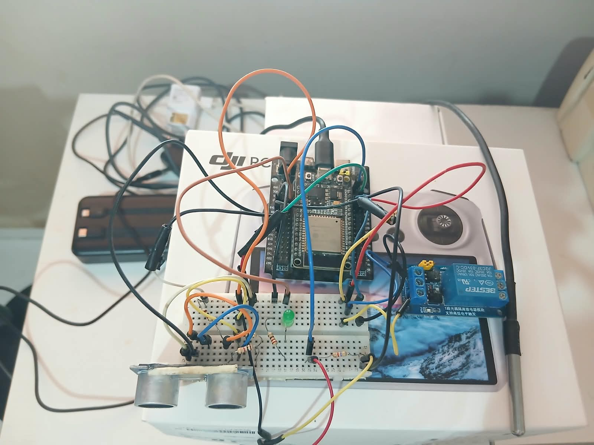
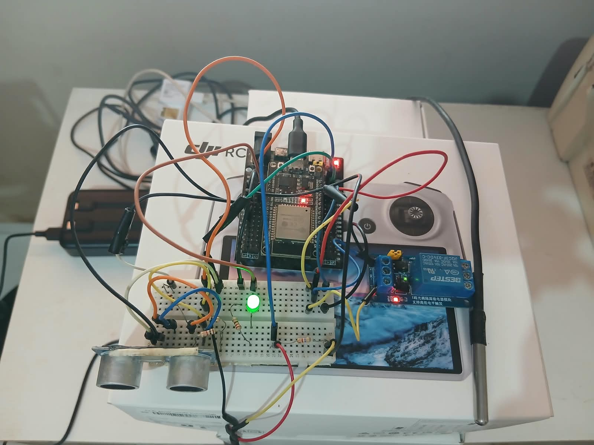
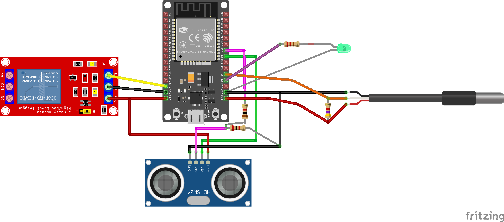

# SalaIOT

Prototipo de monitoramento e controle de uma sala com ESP32. O firmware mede presenca e temperatura, publica os dados via MQTT e permite ligar ou desligar um LED e um rele pelo broker.

Placa: `esp32doit-devkit-v1` (PlatformIO + Arduino). Base dos topicos: `casa/sala1`.

## Prototipo

Vista de cima, com os sensores desligados e ligados.

| Sensores desligados | Sensores ligados |
| --- | --- |
|  |  |

## Montagem (Fritzing)

Diagrama da ligacao dos sensores na protoboard.



## Hardware

| Componente | Funcao | Ligacao |
| --- | --- | --- |
| ESP32 DOIT DevKit V1 | Controlador | Wi-Fi + MQTT |
| HC-SR04 | Presenca (distancia) | VCC 5V (VIN), GND, TRIG GPIO5, ECHO GPIO18 |
| DS18B20 | Temperatura | VCC 3V3, GND, DATA GPIO4 |
| LED | Indicacao | GPIO2 (LED da placa) ou externo com 220 ohm |
| Modulo rele | Saida de carga | IN GPIO13, VCC do modulo (em geral 5V), GND comum |

O ECHO do HC-SR04 sai em 5 V. Use um divisor resistivo (1k / 2k) antes do GPIO18. O DS18B20 precisa de um resistor de 4,7k entre DATA e 3V3.

A presenca usa a distancia do ambiente vazio como base. No boot, e ao enviar o comando `calibrar`, deixe a sala vazia por cerca de 2 segundos. A velocidade do som e compensada com a temperatura do DS18B20.

## Software

Bibliotecas (ja listadas em `platformio.ini`):

- `knolleary/PubSubClient`
- `paulstoffregen/OneWire`
- `milesburton/DallasTemperature`

Arquivos:

- `src/main_completo.cpp` — Wi-Fi, MQTT, publicacao e comandos
- `include/presenca_hcsr04.h` — leitura do HC-SR04 em task FreeRTOS
- `include/temperatura_ds18b20.h` — leitura do DS18B20
- `include/saidas.h` — LED e rele

Antes de gravar, ajuste em `src/main_completo.cpp` o SSID, a senha do Wi-Fi, o host e a porta do broker (`MQTT_HOST`, porta 1883) e o identificador `esp32-sala1`. Nao commite senha real no repositorio.

```bash
pio run -t upload
pio device monitor
```

Monitor serial em 115200. No boot o LED e o rele iniciam desligados.

## MQTT

O dispositivo publica a cada 1 segundo e tambem quando a presenca muda. Comandos devem ser enviados **sem** retain: um comando retido seria reaplicado a cada reconexao e poderia ligar o rele sozinho.

| Topico | Direcao | Payload |
| --- | --- | --- |
| `casa/sala1/dados` | publica | JSON com distancia, base, presenca, temperatura e estado das saidas |
| `casa/sala1/presenca` | publica (retido) | `1` ou `0` |
| `casa/sala1/led/estado` | publica (retido) | `ON` ou `OFF` |
| `casa/sala1/rele/estado` | publica (retido) | `ON` ou `OFF` |
| `casa/sala1/status` | publica (retido) | `online` ou `offline` (ultima vontade) |
| `casa/sala1/led/set` | escuta | `on`, `off`, `toggle`, `1` ou `0` |
| `casa/sala1/rele/set` | escuta | `on`, `off`, `toggle`, `1` ou `0` |
| `casa/sala1/cmd` | escuta | `calibrar` (ambiente vazio) |

Exemplo do JSON em `casa/sala1/dados`:

```json
{"d":42.1,"base":180.0,"p":1,"ok":1,"t":26.4,"tok":1,"led":0,"rele":0,"up":12}
```

`d` e `base` estao em centimetros, `t` em graus Celsius. `p`, `ok`, `tok`, `led` e `rele` sao 0 ou 1. `up` e o tempo ligado, em segundos.

Exemplo de comando (mosquitto, sem retain):

```bash
mosquitto_pub -h <broker> -t casa/sala1/led/set -m on
mosquitto_pub -h <broker> -t casa/sala1/cmd -m calibrar
```
